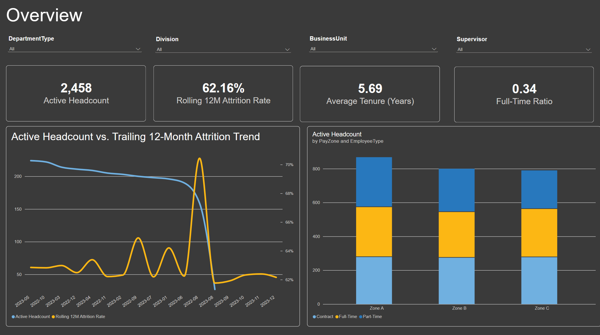
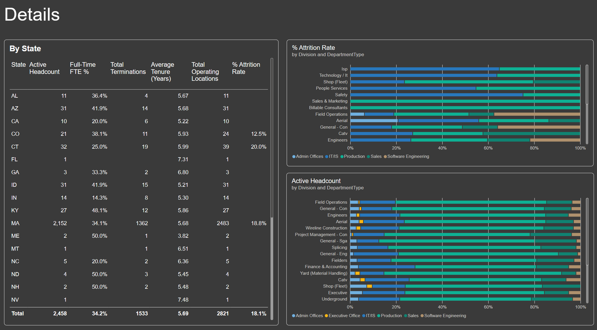
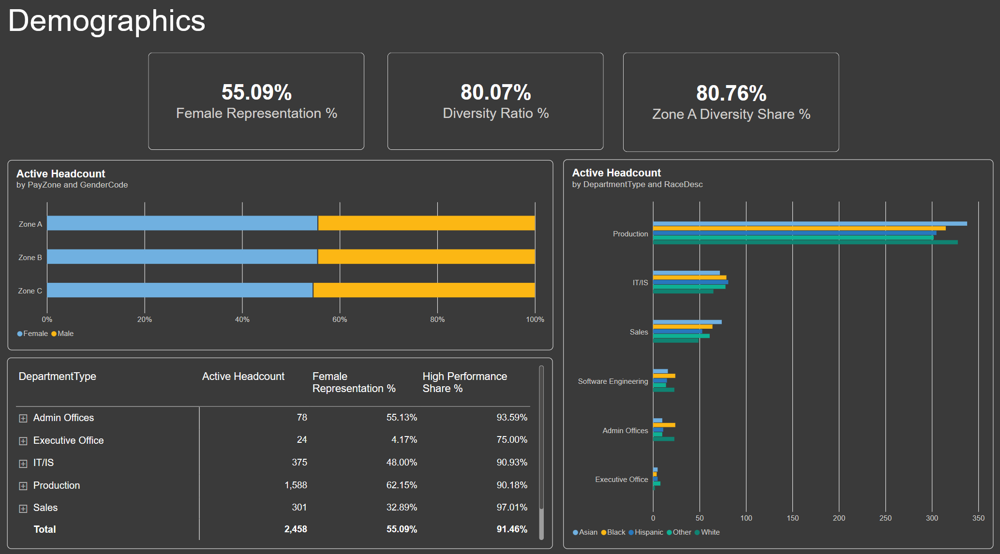

# Enterprise People & Workforce Analytics Platform (Power BI)

## Skills Showcased Using This Project

Advanced Power BI Architecture: Building an enterprise-grade multi-table relational Star Schema with proper cardinality, single-direction cross-filtering, and a dedicated calendar dimension (Dim_Calendar).

Complex DAX Engineering: Writing advanced analytical measures for rolling time intelligence (e.g., Trailing 12-Month Attrition), workforce mobility, diversity distribution ratios, recruitment conversion funnels, and cost-per-hire analytics.

Power Query ETL & Data Modeling: Consolidating and cleaning raw multi-source enterprise data files (employee_data, engagement_survey, recruitment_data, and training_and_development) to build unified relationship models.

Executive Dashboard Design & UX: Designing a multi-page cohesive business application layout featuring dynamic BAN KPI cards, conditional formatting, synchronized cross-filtering slicers, and structured data matrices.

## Project Details

Critical human capital information spanning employee records, geographic footprints, recruitment pipelines, engagement surveys, and training program outcomes siloed across disconnected files. 

### Data Sources

The project models an enterprise repository using four core relational entities:

employee_data.csv: Core active headcount, tenure, location, supervisor tracking, and organizational demographics.

employee_engagement_survey_data.csv: Event-level sentiment metrics tracking engagement, satisfaction, and work-life balance scores.

recruitment_data.csv: Pre-hire applicant funnel metrics, education levels, desired salary expectations, and status stages.

training_and_development_data.csv: Professional development catalog tracking completion outcomes, duration days, and total training expenditures.

Credit: https://www.kaggle.com/datasets/ravindrasinghrana/employeedataset

### Quick Executive Summary of the Report Pages

Page 1: Executive Workforce Overview

    Tracks core KPIs including 2,458 Active Headcount, a 62.16% Rolling 12M Attrition Rate, an average employee tenure of 5.69 years, and a 0.34 Full-Time Ratio.

    Visualizes headcount trends against rolling attrition velocity and active headcount segmentation across pay zones and employee types.

Page 2: Geographic & Organizational Distribution

    Analyzes a national footprint spanning 2,821 operating locations with primary worker concentration in Massachusetts (2,152 active headcount).

    Evaluates division span-of-control, detailing how department types are distributed across corporate service sectors and field operations.

Page 3: Demographics & Diversity Analytics

    Uncovers workforce representation metrics, showing a 55.09% Female Representation rate, an 80.07% Diversity Ratio, and performance rating distributions across racial and gender cohorts.

Page 4: Recruitment & Talent Acquisition Pipeline

    Manages an active candidate funnel of 1,796 open requisitions, yielding a 20.33% Candidate Conversion Rate and tracking an average cost-per-hire benchmark alongside education-level salary expectations (~$65k average desired salary).

Page 5: Training & Employee Sentiment Analysis

    Evaluates a $1.68M total training investment split evenly between internal and external programs, achieving a 50.30% Program Success Rate.

    Summarizes departmental sentiment, revealing stable engagement averages (~2.94) and satisfaction scores (~3.02) across business units.

## Next Steps & Future Enhancements for a Production scale project

Predictive Attrition Modeling: Integrate Python machine learning scripts (via Power BI integration or Azure ML) to score individual flight-risk probabilities before termination occurs.

Automated Data Refresh Pipelines: Transition the local CSV flat-files into an automated Azure SQL Database or Snowflake cloud data warehouse pipeline.

Row-Level Security (RLS): Implement dynamic role-based security so regional HR business partners can securely view only their respective geographic clusters.

## Report Screenshots

